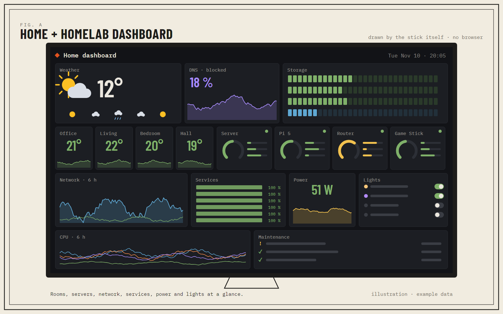
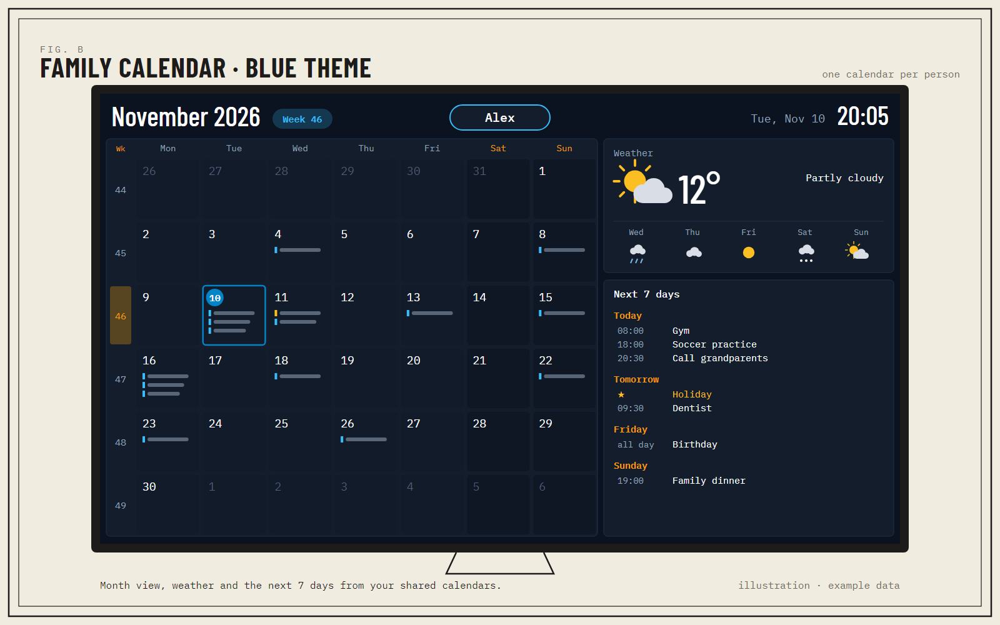
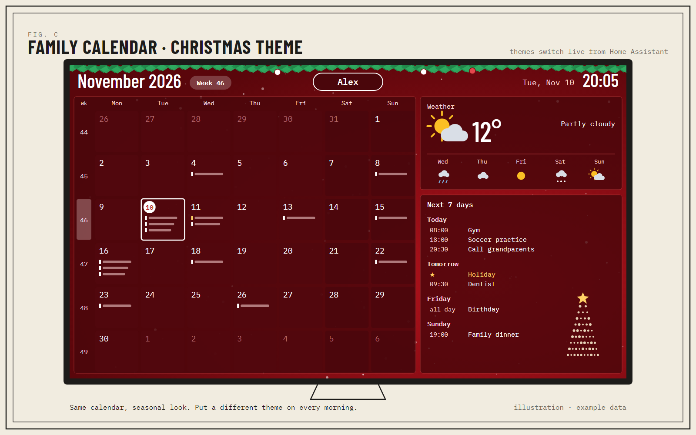
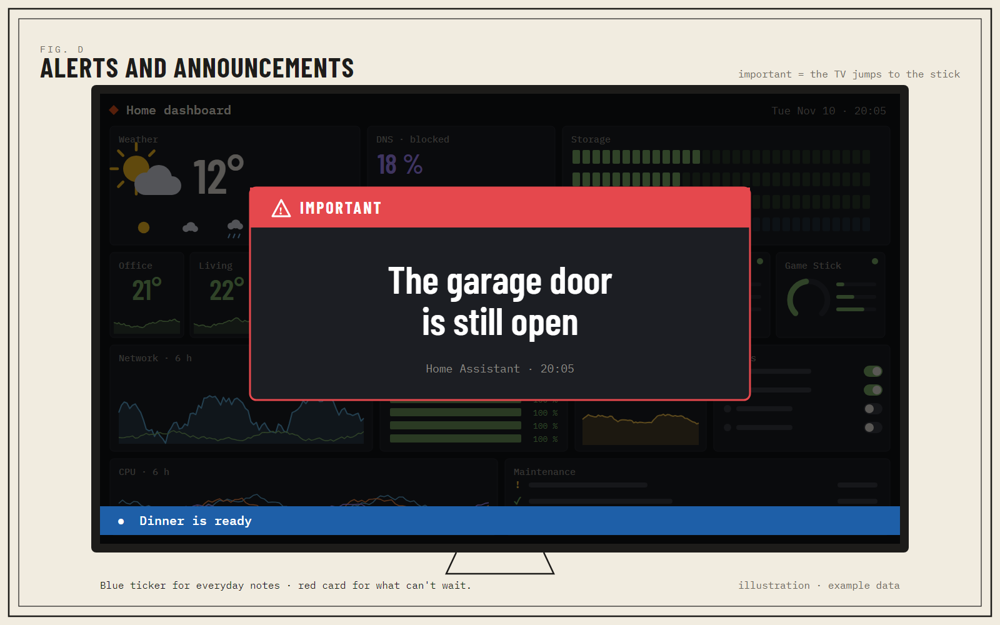
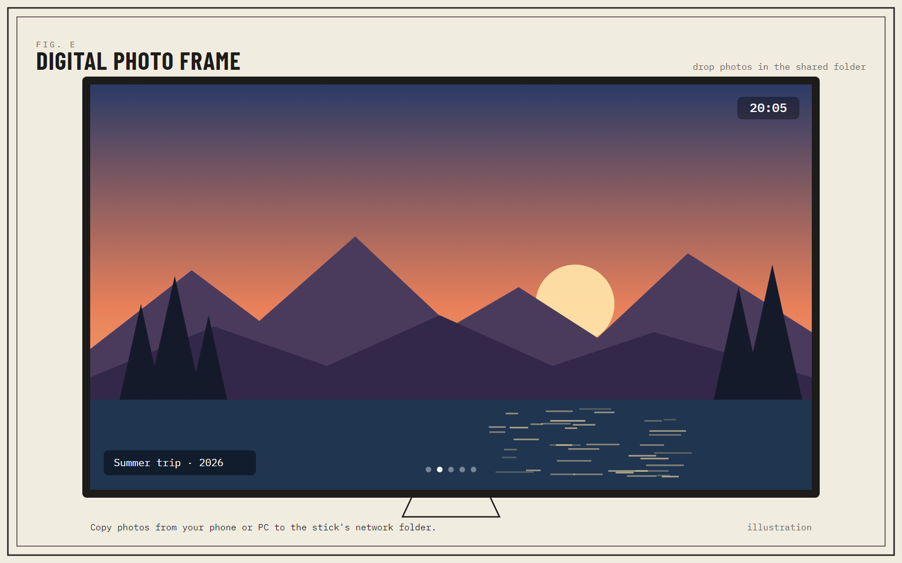

# Build it yourself: step-by-step prompts

This guide has no code to download. Instead, you rebuild the project with an AI coding assistant that can run commands on your computer (Claude Code, Codex or similar). Each stage gives you:

- **Goal**: what you get at the end of the stage.
- **Prompt**: text to paste into the assistant.
- **You do**: the physical steps only you can do (swap the card, plug things in).
- **Check**: how to know it worked before moving on.

It's a recipe to adapt, not an installer: your assistant will write its own code, and your result may look different from mine. That's fine.

---

## Before you start

### What you need

| | |
|---|---|
| **The stick** | "Game Stick Lite 4K" with an **Allwinner** chip (marked MG99 or H133 on the board). ⚠️ There's a HiSilicon version that looks identical outside; this guide doesn't apply to it. |
| **A second microSD** | 32 GB or more (A1). The factory card stays untouched in a drawer. |
| **microSD reader** | for your computer. |
| **A computer** | Windows with **WSL2** (Ubuntu), Linux, or a Mac with **Docker** or a Linux VM. About 10 GB free. |
| **AI assistant with a terminal** | Claude Code, Codex or similar, running on that computer. |
| **Network for the stick** | a **USB Wi-Fi dongle**, a **USB-Ethernet adapter**, or an **ESP32 with Wi-Fi** (I used an ESP32-C6) as a USB network bridge. The stick has no network of its own. |
| **Power** | a 5 V / 2 A USB charger. The TV's USB port is often not enough once a dongle is plugged in. |
| **Adapters** | whatever your setup needs: a right-angle HDMI adapter if the TV port is tight, USB-A ↔ USB-C for the network module. |
| **A TV or monitor** | with a free HDMI input. A USB keyboard helps for the first boot (optional). |
| **Home Assistant** | optional, but it's what powers the dashboard, calendar, alerts and remote control. No Home Assistant? See [Without Home Assistant](#without-home-assistant). |

Time: an afternoon for Linux + network, a weekend for everything.

### Ground rules for your assistant

Paste this first, once, at the start of the session:

```text
We're going to turn a retro "Game Stick Lite 4K" (Allwinner sun8iw20 / T113 family, 256 MB RAM,
boots only from microSD, stock Tina Linux kernel 5.4.61) into a small Linux home server and TV panel.
Rules for the whole project:
- Work inside WSL/Linux in a folder called game-stick/. Keep every script there, numbered by stage.
- NEVER write to a disk or SD card without showing me the device name, its size and partitions,
  and waiting for me to type "yes". Never touch my computer's own disks.
- Never put passwords, tokens or keys inside scripts or files we might share: read them from
  files on the stick with permissions 600, or ask me at the time.
- Keep the stick's bootloader and kernel exactly as they come from the factory.
- After each stage, tell me what to check on the TV and stop.
```

---

## Stage 1 — Back up the factory card

**Goal:** a full image of the original card, so you can always go back to the game console.

**You do:** put the **factory** card in the reader.

**Prompt:**

```text
Stage 1. Find the microSD reader (show me the list and wait for my confirmation), then make a
full image of the card to game-stick/backup/factory.img and a sha256 next to it. Read only.
Then, without writing anything, list the partition table of the image (it should be a GPT with
about 8 partitions) and tell me what each partition seems to contain (boot0, U-Boot, kernel,
a squashfs rootfs, the games partition...).
```

**Check:** you have `factory.img` and its checksum, and a table of partitions. Put the factory card away.

---

## Stage 2 — Understand the stock system

**Goal:** know exactly which kernel you're dealing with.

**Prompt:**

```text
Stage 2. Inspect factory.img offline (loop devices, read only):
- Extract the kernel from its partition and get its version string and, if the kernel was built
  with IKCONFIG, its .config (scripts/extract-ikconfig). Save it as game-stick/kernel.config.
- Mount the squashfs rootfs and list the kernel modules it ships, plus the "vermagic" of one of them.
- Tell me: is there fbcon (text console on HDMI)? which framebuffer size? which USB and network
  drivers are built in? is TUN available? nftables or legacy iptables?
Summarize what we'll have to add ourselves.
```

**Check:** you should find roughly: kernel 5.4.61 (Tina, Android common base), framebuffer 1280×720 32 bpp, **no fbcon**, **no Wi-Fi or USB-Ethernet drivers**, no TUN.

---

## Stage 3 — Take over the boot (without touching the kernel)

**Goal:** prove that *your* code runs on the stick.

The trick: keep boot0, U-Boot and the kernel as they are, and replace only the small read-only rootfs partition with your own tiny "launcher".

**Prompt:**

```text
Stage 3. Build a tiny launcher for the rootfs partition of the stock layout:
- A static BusyBox for ARMv7 (cross-compile) and a squashfs image with /sbin/init as a shell script.
- Since there's no fbcon, write a very small static C program that draws a few lines of text
  directly on /dev/fb0 (1280x720, 32 bpp) using a PSF font, so we can see messages on the TV.
- For now init only mounts proc/sys/dev, shows "Hello from my launcher" plus the kernel version
  on screen, and waits.
- Prepare a copy of factory.img with ONLY that partition replaced, and write it to the NEW card
  (ask for confirmation first).
Important: don't enable a serial console on ttyS0 — on this board it shares pins with the SD
card and freezes the system.
```

**You do:** put the new card in the stick, plug it into the TV.

**Check:** your message appears on the TV. If the screen stays black, ask the assistant to log each boot step to a spare partition you can read back on your computer.

---

## Stage 4 — Alpine Linux

**Goal:** a real Linux system with a package manager, on the big partition.

**Prompt:**

```text
Stage 4. Put Alpine Linux (latest stable, armv7) on the large games partition:
- Build the root filesystem in a chroot with qemu-user-static; install alpine-base, openrc,
  busybox-extras, openssh, chrony, e2fsprogs, sfdisk, nano.
- Change the launcher's init: mount that partition (ext4) and switch_root into Alpine's init.
  If anything fails, show the reason on screen with our framebuffer program.
- Set a hostname, ask me for a root password (don't store it in the scripts), and install my
  SSH public key from a path I give you.
- On first boot, grow the partition to the end of the card.
- Turn this into one script that builds the whole image, so we can repeat it.
```

**Check:** the TV shows Alpine booting (or at least your launcher handing over). You'll log in over the network in the next stages.

---

## Stage 5 — A terminal on the TV

**Goal:** a login prompt on HDMI, since the kernel has no text console.

**Prompt:**

```text
Stage 5. The stock kernel has no fbcon, so we need a terminal that draws on /dev/fb0 itself.
First try to build an existing framebuffer terminal (for example yaft) statically for ARMv7.
If it doesn't fit our needs, write a small one in C: VT100 subset, 256 colors, UTF-8, a large
PSF font, reading a USB keyboard from /dev/input. Run it on the TV from inittab with login.
Leave room for "layers" on top of the terminal later (a background image, a photo, a ticker).
```

**Check:** you can log in on the TV with a USB keyboard and run `top`.

---

## Stage 6 — Network

**Goal:** the stick on your home network. Pick **one** option.

The stock kernel is Tina 5.4.61 on an Android common base: its internal structures have extra fields, so modules built from kernel.org sources won't load. Build them from the Tina 5.4 source instead (public: `paulwratt/mangopi-sbc-tina-linux-5.4` on GitHub), with the config you extracted in Stage 2.

**Prompt (modules, needed for A and B):**

```text
Stage 6a. Build kernel modules that load on the STOCK kernel:
- Use the Tina 5.4 source (github.com/paulwratt/mangopi-sbc-tina-linux-5.4) with our extracted
  kernel.config. The vermagic must match the stock one exactly; check CRCs/modversions too.
  (Newer GCC versions may need small Makefile tweaks for -march.)
- Build as modules: TUN; usbnet with AX88179, ASIX, Realtek r8152 and CDC Ethernet;
  cfg80211 + mac80211 and USB Wi-Fi drivers: rt2800usb, mt7601u, mt76x0u, mt76x2u, ath9k_htc,
  rtl8192cu, rtl8xxxu, with their firmware from Alpine's linux-firmware packages.
- Install them into the image so they load automatically when a device is plugged in.
Test that each .ko at least loads (modinfo, then insmod on the stick).
```

**Option A — USB Wi-Fi dongle**

```text
Stage 6b. Configure wpa_supplicant + dhcpcd so the stick joins my Wi-Fi when a dongle is plugged
in. Ask me for the SSID and password at install time and store them only on the stick (600).
```

**Option B — USB-Ethernet adapter**

```text
Stage 6b. Configure dhcpcd so any USB-Ethernet adapter gets an address automatically.
```

**Option C — ESP32 with Wi-Fi as a USB network bridge**

```text
Stage 6b. Write ESP-IDF firmware for my ESP32 (model: ...) that joins my Wi-Fi and gives the
stick network over USB: a PPP link over USB CDC-ACM (stick side /dev/ttyACM0 with pppd), NAT on
the ESP32, and port forwarding for SSH. Wi-Fi credentials go in a local config file that is
git-ignored. On the stick, add a service that waits for the ESP32 and keeps the PPP link up.
Optional: make the ESP32 also accept a Bluetooth keyboard and forward keystrokes to the stick.
```

**Check:** from your computer, `ssh root@<stick-ip>` works.

---

## Stage 7 — Remote access and a shared folder

**Goal:** reach the stick from anywhere and drop files on it from any device at home.

**Prompt:**

```text
Stage 7. Add:
- Tailscale (official static armv7 build). Use the real TUN module and --netfilter-mode=off
  (this kernel has no nftables). I'll run "tailscale up" myself.
- A Samba share called "media" on the big partition, limited to 10 GB as seen from other
  computers (use a "dfree command" script), guest-free: ask me for a Samba password.
- A small web page (busybox httpd) with: a web terminal (ttyd), a live mirror of what's on the TV
  (read /dev/fb0, convert to an image, refresh every second), and buttons to send a message.
  Protect it with a password.
- A simple text menu ("menu" command) to set passwords, Wi-Fi, tokens and services.
```

**Check:** the `media` share shows up on your computer and phone; the web page mirrors the TV.

---

## Stage 8 — The dashboard

**Goal:** a live dashboard on the TV, drawn by the stick itself (no browser: 256 MB of RAM won't run one).



**Prompt:**

```text
Stage 8. Build a dashboard rendered on the stick:
- A small C renderer with anti-aliasing (lines, filled areas, arcs, rounded panels, text from a
  pre-rendered font atlas) that reads a simple "scene" text file and writes a raw image; cache the
  static parts. It must stay light: target under 5 % CPU on a Cortex-A7.
- A Lua script that every 30 s gets the data from Home Assistant (POST /api/template with one
  Jinja template that returns a compact JSON), writes the scene and shows the result as a
  background layer of our terminal.
- 6-hour charts from HA's long-term statistics over the WebSocket API (recorder/statistics_during_period).
- Panels: weather, rooms (temperature, humidity, presence by HA area), servers, network,
  services, power, lights. Which entities show up is decided in HA with a label "Panel TV".
- Read the screen's EDID: a monitor uses the full screen, a TV gets a margin for overscan.
The HA token lives in a file on the stick (600); ask me to paste it there myself over SSH.
```

**Check:** the dashboard appears and `top` shows low CPU use.

---

## Stage 9 — The family calendar

**Goal:** a second screen: the month, the weather and the next 7 days.



**Prompt:**

```text
Stage 9. Add a "calendar" design to the same renderer:
- Month grid (Monday first) with ISO week numbers, today highlighted, events as small bars.
- Events from HA calendars (calendar.get_events) — a family calendar plus a public holidays one —
  and the daily forecast (weather.get_forecasts).
- A "next 7 days" agenda and a weather panel.
- Themes: colors + an optional background image + a person's name in the header. Start with a
  dark blue theme and a Christmas theme. Draw the backgrounds with code (Python + Pillow), no
  stock images.
- Switch design and theme live (no restart) when a config file changes.
```

**Check:** you can switch between dashboard and calendar, and between themes, in about a second.



---

## Stage 10 — Control it from Home Assistant (MQTT)

**Goal:** the stick appears in Home Assistant as a device, with sensors and controls.

**Prompt:**

```text
Stage 10. Make the stick a Home Assistant device via MQTT discovery (Mosquitto add-on):
- One retained "device" discovery message with all entities; availability with last will.
- Sensors: chip temperature, CPU, RAM, SD use, shared-folder use, network traffic, Tailscale,
  HDMI connected, screen resolution (and the ESP32's Wi-Fi signal if we use one).
- Buttons: restart, power off, refresh dashboard, clear message, show last photo.
- Selects: design (dashboard / calendar), calendar theme, screen mode (dashboard / terminal).
- Switches: HDMI picture on/off, Samba, web page, Tailscale exit node.
- A text entity that writes to the ticker.
Publish state every 30 s and right after any command. Use mosquitto-clients; the MQTT password
is stored only on the stick. Add a "menu" option and a web page to enter the MQTT user.
```

**Check:** in Home Assistant, *Settings → Devices* shows your stick; pressing "Refresh dashboard" works.

---

## Stage 11 — Alerts and announcements

**Goal:** messages from Home Assistant on the TV, with two levels.



**Prompt:**

```text
Stage 11. Add messages over MQTT:
- Normal: a ticker line on the dashboard (blue), for a few minutes.
- Important: a large red card in the middle of the screen.
- A photo message: show an image with a caption.
- In Home Assistant, a script "show on TV" with text, level and duration. If my TV has an HA
  integration, the script switches the TV to the stick's HDMI input for important messages and
  then back to the previous input; skip photos at night.
- Optional voice: HA text-to-speech (tts_get_url) played by the stick through HDMI audio
  (mpg123/ALSA), exposed as a notify entity "Speak on TV".
```

**Check:** an automation (for example "garage door open for 10 minutes") shows the red card.

---

## Stage 12 — Digital photo frame

**Goal:** a slideshow of the photos you drop in the shared folder.



**Prompt:**

```text
Stage 12. Add a "photo frame" mode: show the images from the "media" share full screen
(scale and letterbox to the visible area; JPEG and PNG), one every N seconds, with an optional
caption from the file name and a small clock. Pick up new files automatically. Add it to the
design select in Home Assistant and a schedule (for example photos in the evening, calendar in
the morning).
```

**Check:** copy a photo from your phone to the `media` share; it shows up on the next turn.

---

## Stage 13 — Make it repeatable

```text
Stage 13. Review the whole folder: one command should build the full image from factory.img,
another should write it to a card (with confirmation). Make sure no password, token, Wi-Fi key or
personal IP is inside any file meant to be shared, and write a short README for future me.
```

Keep the factory card and `factory.img`. To play again, just put the factory card back.

---

## Without Home Assistant

The stick doesn't need Home Assistant for Linux, the shared folder, Tailscale or the photo frame. For the rest, ask your assistant to use:

- **Dashboard:** Uptime Kuma, Glances, Netdata or any JSON API.
- **Calendar:** the private iCal (`.ics`) link from Google Calendar or iCloud.
- **Alerts:** [ntfy](https://ntfy.sh) or a simple `curl` to the stick's web page.
- **Remote control:** Tailscale + the stick's web page.

## Things that took me time (so they don't take yours)

- **No text console:** the stock kernel has no fbcon, so you won't see boot messages on HDMI. Your own framebuffer program is the only window into the boot.
- **Don't use the serial console:** on this board, `ttyS0` shares pins with the SD card and freezes the system.
- **Kernel modules:** kernel.org sources don't match the Android-common-based Tina kernel. Use the Tina 5.4 source and the stock config.
- **Tailscale:** works with real TUN and `--netfilter-mode=off`.
- **Power:** if the stick reboots when you plug in the network module, use a separate 5 V / 2 A charger.
- **Overscan:** TVs cut the edges. Read the EDID and add a margin only on TVs.
- **HDMI-CEC:** the stick's own CEC may not reach your TV. In my case, Home Assistant wakes the TV through another HDMI device.
- **No video:** there's no hardware video decoding here. Images, yes; video, no.
- **No clock battery:** time comes from the network (chrony).
