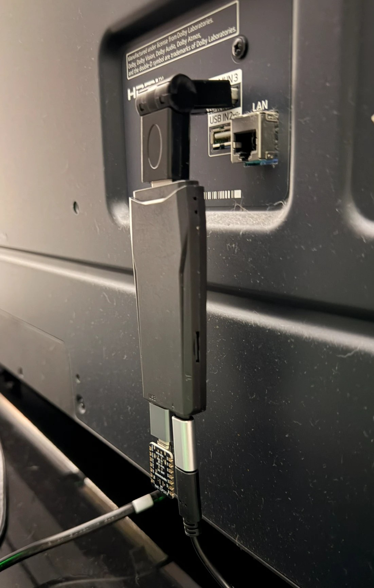
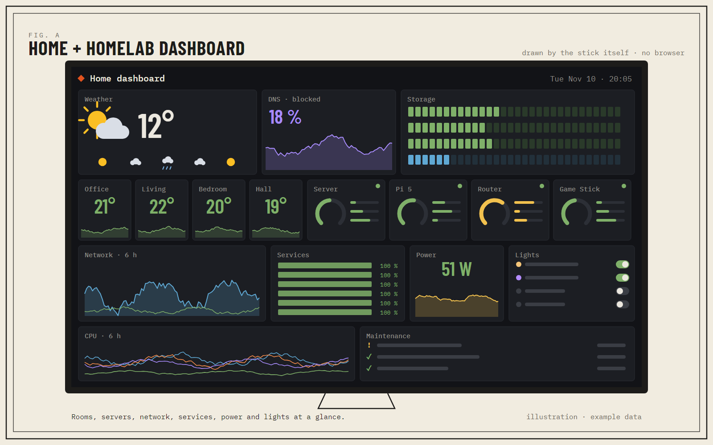
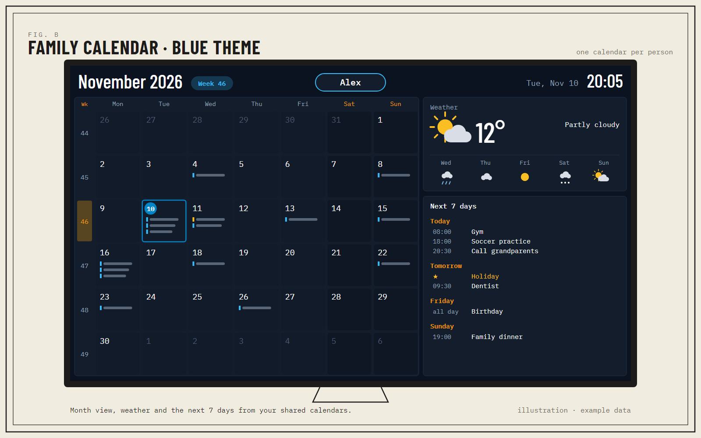
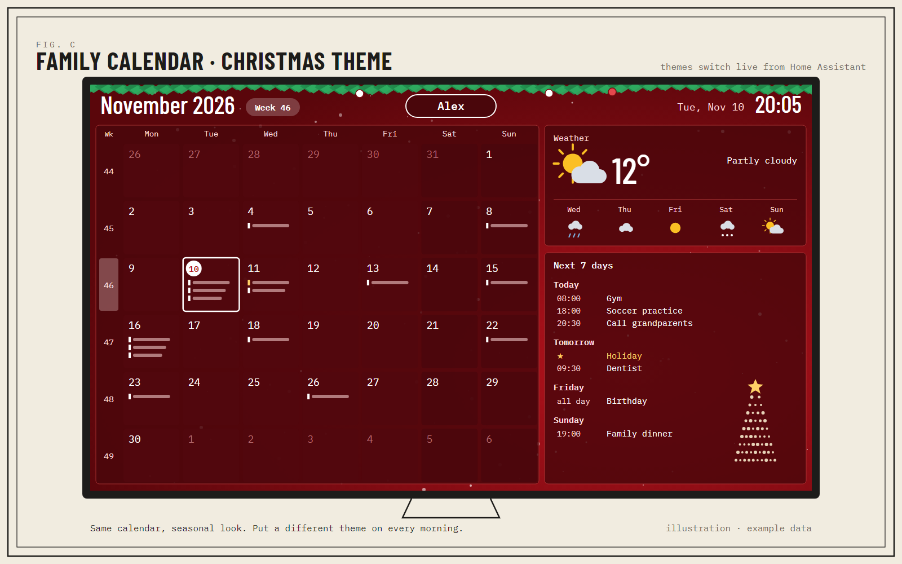
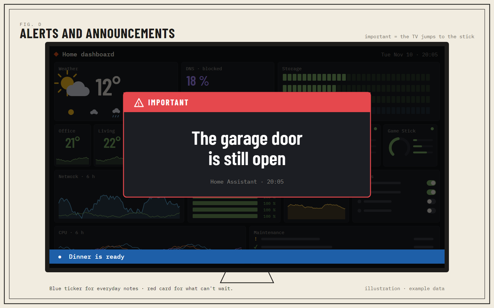
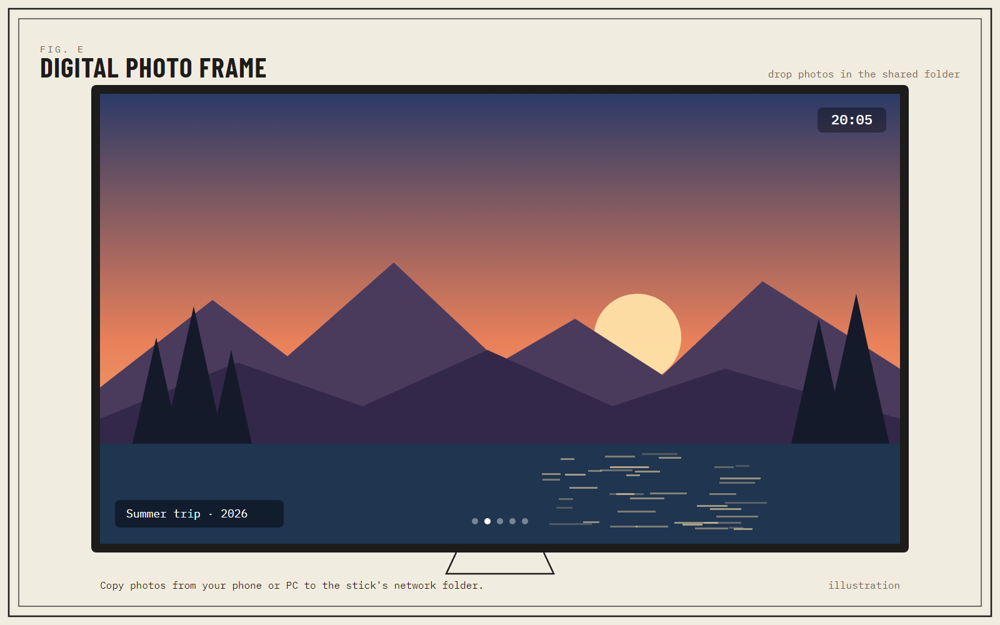
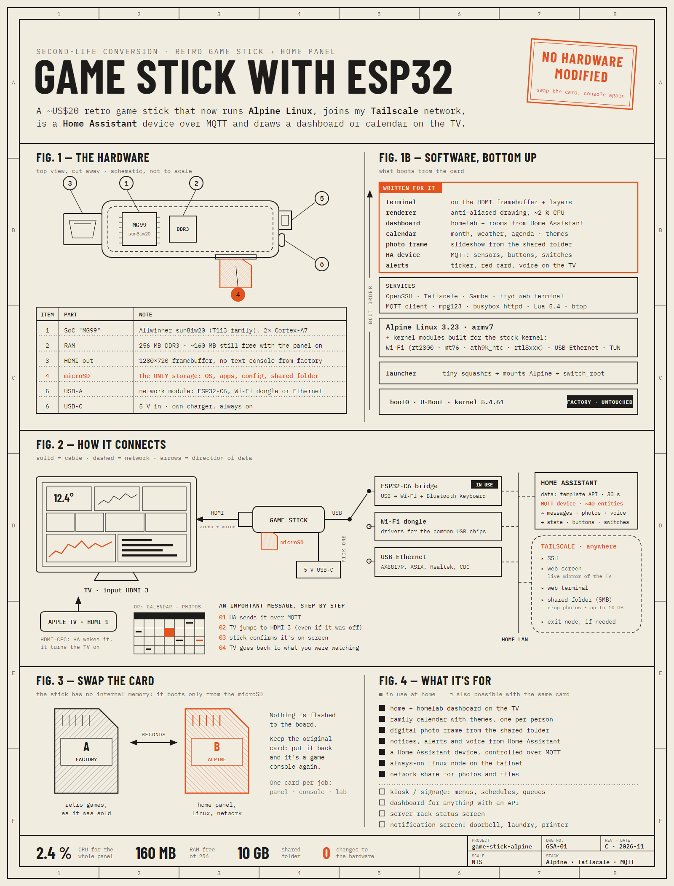

# Game Stick Alpine

**Got a retro game stick in a drawer? Don't throw it away. Give it a second life.**

Those ~US$20 HDMI "Game Stick Lite 4K" consoles have a small ARM computer inside. Mine now runs a lightweight **Alpine Linux** and works as a tiny always-on home server behind the TV:

- **Shares files** on your home network (drop photos from your phone or PC).
- Shows a **home + homelab dashboard** on the TV.
- Shows a **family calendar** with weather and the week ahead.
- Shows **alerts and announcements** from Home Assistant.
- Works as a **digital photo frame**.
- Joins your **Tailscale** network, so you can reach it from anywhere.
- Appears in **Home Assistant** as a device you can control.

And it costs nothing to try: **the stick boots only from the microSD card**. Nothing is flashed to the board. Keep the original card and it's a game console again whenever you want.

---

## What it looks like

| | |
|---|---|
|  |  |
|  |  |

Illustrations with example data.

## How it fits together

- **The stick:** Allwinner chip (T113 family), 2 ARM cores, 256 MB of RAM, HDMI, one USB port and a microSD slot. No Wi-Fi, no text console out of the box.
- **The trick:** the factory bootloader and kernel stay untouched. A tiny launcher on the card hands over to Alpine Linux.
- **Network over USB, your choice:** a USB Wi-Fi dongle, a USB-Ethernet adapter, or an ESP32 with Wi-Fi acting as a bridge (that's what I use).
- **Light on purpose:** no browser, no desktop. The stick draws the dashboard itself and uses about **2–3 % CPU**.

## How I used AI

I built this with an AI coding assistant (Claude Code) working on my own computer. I brought the idea, the hardware and the decisions; the assistant did most of the reading, writing and debugging. Roughly:

| Process | What the AI did | What I did |
|---|---|---|
| Understanding the stick | Read the backup of the factory card, mapped its partitions, found the chip and the stock kernel's limits | Made the backup, asked the questions |
| Booting Linux | Wrote the launcher and the Alpine build scripts, figured out why early boots failed | Swapped cards, watched the TV, reported what I saw |
| Kernel modules and network | Built Wi-Fi, USB-Ethernet and TUN modules for the stock kernel, wrote the ESP32-C6 bridge firmware | Chose the network module, plugged things in, tested |
| On-screen software | Wrote the framebuffer terminal, the renderer, the dashboard, the calendar and its themes | Decided what to show, the look, and what was good enough |
| Home Assistant | Wrote the MQTT device, the alerts and the HA scripts | Set up HA, entities and labels, and kept my tokens and passwords out of the chat |
| Debugging | Read logs, proposed fixes, measured CPU and RAM | Ran the tests at home, with the real TV |
| This page | Drafted the README, the guide, the illustrations and the infographic | Reviewed, corrected and approved everything |

Every step that writes to a card or changes something at home was confirmed by me first. The guide follows the same rule.

## Make your own

There's no code to download here. Instead, **[GUIDE.md](GUIDE.md)** walks you through it stage by stage, with **ready-to-paste prompts for an AI coding assistant** (Claude Code, Codex or similar) that builds everything on your own computer:

1. Back up the factory card
2. Understand the stock system
3. Take over the boot (without touching the kernel)
4. Alpine Linux
5. A terminal on the TV
6. Network: Wi-Fi dongle, USB-Ethernet or ESP32
7. Tailscale and a shared folder
8. The dashboard
9. The family calendar
10. Control from Home Assistant (MQTT)
11. Alerts and announcements
12. Digital photo frame
13. Make it repeatable

### What you need

- A **Game Stick Lite 4K with an Allwinner chip** (marked MG99 or H133). ⚠️ A HiSilicon version looks the same outside and won't work.
- A **second microSD** (32 GB+) and a card reader.
- A **PC or Mac** (Windows with WSL2, Linux, or macOS with Docker / a Linux VM).
- An **AI coding assistant** that can run commands: Claude Code, Codex or similar.
- Your **home network**, plus a **USB Wi-Fi dongle**, a **USB-Ethernet adapter** or an **ESP32 with Wi-Fi**.
- A **5 V / 2 A USB charger** for the stick.
- **Home Assistant** and the services you want to see (optional: the guide lists simple alternatives).

## Good to know

- It's a recipe to adapt, not an installer. Your assistant writes its own code, so your result may look a bit different.
- No hardware video decoding: photos yes, video no.
- The stick's own HDMI-CEC may not wake your TV; Home Assistant can do it through another device.
- No vendor firmware, kernels, images or games are shared here. You use the card that came with your stick.

## Related work

- [gamestick-mainline](https://github.com/Maks7594/gamestick-mainline): mainline Linux on a similar T113 game stick.
- [4PDA thread: Game Stick Lite v110 / v8 / h133](https://4pda.to/forum/index.php?showtopic=1076444): Russian forum about this board family.
- [GStickOS](https://lucamot.github.io/GStickOS/): retro gaming image for the HiSilicon variant.

## License

Guide, prompts and images: [MIT](LICENSE). Not affiliated with the stick's maker. Do this at your own risk and keep a backup of your card.
